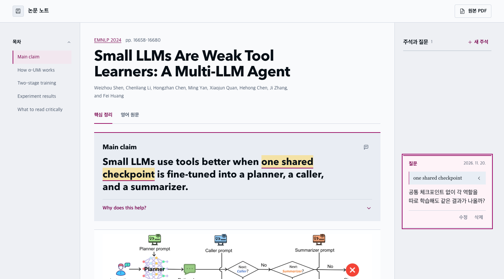

# Paper Notes

**논문을 읽고, 근거를 따라가고, 궁금한 점을 문장 옆에 남기는 도구.**

영어 원문을 한 열에 펼쳐 읽고, 핵심 주장 아래의 근거를 하나씩 열어 볼 수 있어요. 주석은 선택한 문장 옆에 표시됩니다.

[시작하기](#시작하기) · [읽기와 주석](#읽기와-주석) · [에이전트에게 정리 맡기기](#에이전트에게-정리-맡기기)



## 시작하기

Python 3.10 이상이 필요합니다. 표준 라이브러리만으로 실행됩니다.

```sh
git clone https://github.com/owenlee0131073-hub/paper-notes.git
cd paper-notes
python3 serve.py
```

[논문 보관함 열기](http://127.0.0.1:8765/) · [첫 논문 바로 읽기](http://127.0.0.1:8765/2024.emnlp-main.929/)

## 읽기와 주석

1. **핵심 정리**에서 결론 한 문장을 읽고, 더 궁금한 근거를 펼칩니다. 근거의 출처 링크로 원문의 해당 절이나 표로 이동할 수 있어요.
2. **영어 원문**에서 본문과 부록을 한 열로 읽습니다. 그림과 표를 클릭하면 원본 PDF의 해당 페이지가 열립니다.
3. **주석 달기**는 한 문단 안에서 문장을 선택한 뒤 **선택에 주석 달기**를 클릭하거나 <kbd>⌥</kbd><kbd>⌘</kbd><kbd>M</kbd>을 누르면 됩니다. 입력창에서 **주석** 또는 **질문**을 선택하고 저장하세요.
4. **나중에 다시 보기**는 강조 표시나 주석 카드의 인용문을 누르면 됩니다. 모바일에서는 상단 **주석** 버튼으로 하단 패널을 엽니다.

본문 위치 없이 메모를 남기려면 **새 주석**을 사용하세요. 개인 주석은 해당 논문 폴더의 `annotations.json`에 저장되며 Git 추적에서 제외됩니다.

## 에이전트에게 정리 맡기기

[AGENTS.md](AGENTS.md)에 논문 읽기, 영어 주장과 근거 작성, 출처 확인 절차를 정리했습니다. 에이전트에게는 아래처럼 요청하면 됩니다.

> `AGENTS.md`에 따라 `2024.emnlp-main.929`를 읽고 `study.json`을 작성해 줘. 핵심 주장을 영어 한 문장으로 쓰고, 근거마다 원문의 절·표·그림을 연결해 줘.

[첫 논문의 study.json](2024.emnlp-main.929/study.json)을 형식 예제로 볼 수 있습니다.

## 새 논문 추가하기

논문 ID로 폴더를 만든 뒤 아래 파일을 둡니다. 보관함은 `paper.json`이 있는 논문 폴더를 찾아 표시합니다.

| 파일 | 역할 |
| --- | --- |
| `paper.json` | 제목, 저자, 학회, 출처, 라이선스, 원문 목차 |
| `original.pdf` | 원본 논문 PDF |
| `source.html` | 한 열로 재배치한 영어 원문. 주석을 연결할 문단에는 고유한 `id`와 `data-anchor`를 붙입니다. |
| `figures/` | 본문에 넣을 원본 그림과 표 |
| `study.json` | 영어 핵심 주장, 펼칠 수 있는 근거, 원문 링크 |
| `annotations.json` | 첫 주석 저장 때 생성되는 개인 파일 |

## 첫 논문

*Small LLMs Are Weak Tool Learners: A Multi-LLM Agent*, Shen et al., EMNLP 2024, pp. 16658–16680. 이 데모는 영어 원문을 한 열로 재배치하고 그림과 표를 발췌했습니다. 정확한 조판은 [원본 PDF](2024.emnlp-main.929/original.pdf)에서 확인할 수 있습니다. [ACL Anthology](https://aclanthology.org/2024.emnlp-main.929/) · [CC BY 4.0](https://creativecommons.org/licenses/by/4.0/)
